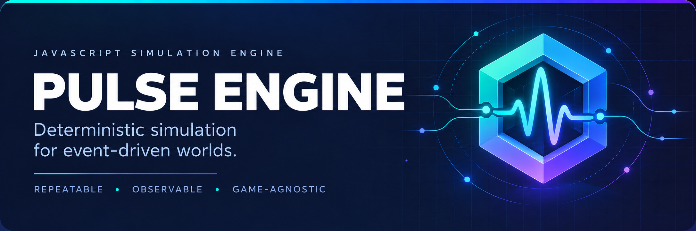

<p align="center">
  
</p>

<div align="center">
  <h1>Pulse Engine</h1>
  <p><strong>A deterministic simulation core for event-driven worlds.</strong></p>
  <p>Build repeatable systems, inspect every decision, and keep game content in its own layer.</p>
  <p>
    <a href="https://github.com/keepithandy/pulse-engine/actions/workflows/engine-quality.yml"></a>
    <a href="https://github.com/keepithandy/pulse-engine/actions/workflows/repository-integrity.yml"></a>
    
    
    <a href="LICENSE"></a>
  </p>
  <p>
    <a href="#quick-start">Quick start</a> ·
    <a href="#capabilities">Capabilities</a> ·
    <a href="#how-the-simulation-behaves">Engine behavior</a> ·
    <a href="#repository-layout">Repository layout</a> ·
    <a href="#documentation">Documentation</a> ·
    <a href="docs/PULSE-ENGINE-DEVELOPMENT-ROADMAP.md">Development roadmap</a>
  </p>
</div>

> [!IMPORTANT]
> **Pulse Engine is pre-alpha.** Its APIs and save formats may change while the engine develops.

## What is Pulse Engine?

Pulse Engine is a framework-independent JavaScript simulation engine for deterministic, event-driven worlds. It provides the reusable machinery for simulation while each game keeps its own story, interface, balance, and content.

**Outpost Zero** is the first separate game planned to use the engine.

The core is a synchronous ES module library. You supply the starting state, systems, rules, and actions; Pulse manages their execution, records events, and exposes the resulting state. A browser interface, command-line tool, or separate game can consume that state without placing presentation logic inside the engine.

This separation is useful when a project needs to reproduce a simulation run, investigate a rule decision, save a world, or exercise game logic without loading a user interface. The headless runner and example scenarios provide an entry point for exploring those workflows.

### Current status

The core roadmap described in [Engine contracts](docs/engine-contracts.md#backlog-verification) has implementations for dispatch, events, rules, randomness, snapshots, scheduling, plug-ins, persistence, scenarios, diagnostics, and compatibility checks. The repository also includes a generic entity/component world model.

**Implemented features do not imply a stable release contract.** Review the contracts and tests when integrating the pre-alpha engine, particularly when depending on snapshot formats or plug-in lifecycle behavior.

### Runtime requirements

| Environment | Requirement |
| --- | --- |
| Node.js | Version 22 or newer; the engine workflow tests Node 22 and 24 |
| Browser | Native ES modules and `structuredClone`; CI exercises Chromium and WebKit |
| Runtime dependencies | No third-party dependencies in the engine runtime |
| Development dependencies | Playwright for browser compatibility checks |
| Simulation data | JSON-safe values; executable hooks stay outside saved state |

## Capabilities

| System | What it provides |
| --- | --- |
| **Actions and rules** | Synchronous action dispatch, ordered systems, rule priorities, conflict groups, and decision traces |
| **Events** | Versioned, immutable event records with deterministic ordering and filtered subscriptions |
| **Time and scheduling** | Explicit ticks, pause and resume controls, and repeatable scheduled actions |
| **Seeded randomness** | Reproducible random state that participates in snapshots and rollback |
| **Snapshots and saves** | Branchable snapshots, JSON save envelopes, validation, and versioned migrations |
| **Plug-ins** | Dependency-ordered setup, action and event hooks, lifecycle management, and disposal |
| **Entity/component world** | Generic entities and JSON-safe components without game-specific rules |
| **Scenarios and runner** | Validated scenario files and a headless command-line runner |
| **Diagnostics** | Read-only inspection, bounded event history, and decision explanations |

The engine is designed to keep the simulation reproducible: dispatching an ordinary action does not advance time, and no wall-clock timer affects simulation behavior.

## Quick start

Pulse Engine currently targets **Node.js 22 or newer**. To work from a local checkout:

```sh
git clone https://github.com/keepithandy/pulse-engine.git
cd pulse-engine
npm ci
npm test
npm run smoke
```

Run the example scenario for ten ticks:

```sh
node bin/pulse-run.js --scenario scenarios/resource-network.json --ticks 10
```

The runner writes deterministic JSON to stdout and exits with a nonzero status for invalid input or runtime failures.

## Use the world model

The generic entity/component world is a plug-in. Consumers define what their components mean and keep their game-specific systems outside the engine.

```js
import {
  createEngine,
  createWorldPlugin,
  queryEntities
} from "./src/index.js";

const engine = createEngine({
  systems: [createWorldPlugin()]
});

engine.dispatch({
  type: "world/entity.create",
  entityType: "worker",
  components: {
    position: { x: 3, y: 5 },
    health: 100
  }
});

const workers = queryEntities(engine.getState(), {
  type: "worker",
  with: ["position"]
});

console.log(workers);
```

For the complete API contract, including dispatch results, scheduling, snapshots, migrations, plug-in lifecycle, and scenario validation, see [Engine contracts](docs/engine-contracts.md).

## How the simulation behaves

### Actions, systems, and rules

An action is a data object with a `type` and any fields needed by the receiving systems. Calling `dispatch()` runs systems in dependency order, then evaluates rules. Rules use unique identifiers, boolean conditions, and effects; higher priorities run first, with identifiers breaking equal-priority ties.

Rules can share a `conflictKey` when only one matching rule in a group should apply. Once a matching rule claims that key, lower rules in the group are skipped. Decision traces record false conditions and conflicts so consumers can inspect why a rule did or did not run.

The dispatch result includes acceptance, the action, revision, tick, and state. Accepted actions also return emitted events and observer-error arrays. A rejection or exception rolls back state and randomness. Pending events are validated before state is committed or observers are notified.

Hooks must run synchronously. Reentrant writes are rejected. State obtained through `getState()` is a copy, allowing consumers to read it without obtaining a mutable reference to live engine state.

### Events and subscriptions

Events describe committed simulation activity. Each envelope includes a version, identifier, type, tick, source, payload, and metadata. Event ordering is deterministic, and event records are deeply frozen.

Use `subscribeToEvents(listener, { type })` to observe events, optionally filtered by type. Use `getEvents({ type, limit })` to read bounded history. State subscriptions are available through `subscribe(listener)`; both subscription APIs return an unsubscribe function.

Observers receive independent data. An observer exception is reported without undoing an already committed action. This keeps presentation or logging failures from silently reversing a successful simulation change.

### Explicit time and scheduling

Ordinary actions leave simulation time unchanged. The host controls progress through these methods:

| Method | Behavior |
| --- | --- |
| `step()` | Attempts one tick, including tick hooks and due scheduled actions |
| `advance(count)` | Advances up to the requested number of ticks, stopping on rejection and respecting pause |
| `pause()` | Prevents `advance()` from progressing |
| `resume()` | Allows `advance()` to progress again |
| `schedule(action, options)` | Queues a future action, optionally with a repeat interval and attempt limit |
| `cancelSchedule(id)` | Removes a scheduled job before it fires |

A rejected tick does not advance time. Manual `step()` remains available while paused, which supports inspecting a simulation one tick at a time.

Scheduled actions run by due tick and insertion order. A failed scheduled action counts as an attempted firing and is reported in the step result; it does not prevent other due jobs from running. Scheduling is bounded, with a default capacity of 10,000 jobs.

### Determinism and seeded randomness

Reproducibility depends on keeping the starting state, seed, systems, rules, and action sequence consistent. The engine captures random state in snapshots and rolls it back when dispatch fails.

Consumer-written hooks also need to preserve this discipline. A system that reads changing external data or generates its own uncontrolled random values can change the outcome of an otherwise identical run. Use the random interface supplied to the hook and make external inputs explicit in the actions you dispatch.

Engine-issued sampling methods expire when their synchronous plug-in hook or engine rule evaluation finishes. Retaining them for observers, later actions, or asynchronous work throws without advancing the generator. Promise results remain unsupported.

## Snapshots and persistence

Snapshots capture simulation state together with the revision, tick, branch identity, random state, event journal, and scheduler. Restore validates the snapshot components before replacing live state.

Capture checkpoints after `dispatch()`, `step()`, or `advance()` returns. Calling `snapshot()`, `fork()`, or `exportSave()` from hooks or observers while an engine operation is running throws, preventing saves of partially completed work.

The following methods operate on an existing engine:

```js
const checkpoint = engine.snapshot({ label: "before-advance" });

engine.advance(10);
engine.restore(checkpoint);
```

A snapshot is simulation data. It excludes functions, listeners, runtime handles, plug-in hooks, diagnostics, and the host's pause preference. Recreate the same systems and rules configuration before restoring into another engine.

For durable saves, `exportSave()` produces a JSON save envelope and `importSave()` migrates and validates it before restoration. A failed import leaves live state unchanged. Migration registries support ordered version transitions and reject missing steps, unsupported future versions, and invalid output.

Save data must remain JSON-safe. Functions, Dates, Maps, undefined values, and cyclic references are rejected. See [Snapshots and persistence](docs/engine-contracts.md#snapshots-and-persistence) for the format and compatibility details.

## Extending the engine

Plug-ins provide a lifecycle around reusable simulation behavior. A manifest declares its identifier, version, dependencies, and any hooks it implements.

| Hook | Responsibility |
| --- | --- |
| `setup` | Initialize the plug-in when registered |
| `onAction` | Participate in action processing |
| `onEvent` | Observe published events |
| `beforeTick` | Run before the tick action |
| `afterTick` | Observe the completed tick |
| `dispose` | Clean up when removed or when the engine is disposed |

Dependencies are initialized before dependents. Duplicate identifiers, missing dependencies, and dependency cycles fail explicitly. A plug-in cannot be unregistered while other registered plug-ins depend on it.

The generic world model demonstrates how reusable state can live inside the simulation: entities are stored under `state.world`, so snapshots and saves include them automatically. Consumers choose component meanings and implement the game systems that use them.

## Scenarios and headless execution

Scenario files describe entities, resources, relationships, a seed, and enabled systems. Validation checks both structure and semantic constraints such as uniqueness and references, reporting errors with JSON paths.

Game-specific fields belong in `gameData`. Consumers can supply a `validateGameData` function for those fields, while `createEngineFromScenario()` requires an explicit allowlist of system factories.

Run a longer scenario and export its event log:

```sh
node bin/pulse-run.js --scenario scenarios/resource-network.json --seed demo --ticks 100 --events events.json
```

| Option | Purpose |
| --- | --- |
| `--help`, `-h` | Show usage without running a simulation |
| `--scenario` | Select the scenario JSON file |
| `--seed` | Supply a seed for the run |
| `--ticks` | Set the requested tick count |
| `--events` | Write the complete run event log to a file |

Every run option requires a nonblank value. Missing values and repeated or unknown options exit with code 1 and a diagnostic on stderr; failed runs do not print a JSON summary. File errors identify the scenario or event-output path that needs attention.

The runner operates without a DOM and limits requested tick counts to one million. Its JSON output can be inspected directly or consumed by another tool.

## Inspection and debugging

Call `inspect()` for a frozen diagnostic view of state, tick, revision, branch, pause status, schedules, plug-ins, events, and traces. Call `getExplanation(actionId)` to inspect the latest retained decision record for an action.

Diagnostics have explicit memory controls: `eventHistoryLimit` and `traceLimit` bound retained history. A consumer-supplied `redact(data)` function operates on a copy to remove sensitive game-owned fields from inspection output.

Setting `diagnostics: false` disables trace collection and causes inspection and explanation queries to return `null`. Diagnostic information is intentionally excluded from snapshots.

## Quality checks

Run the checks locally:

```sh
npm run lint
npm test
npm run test:coverage
npm run check:package
npm run smoke
```

Install the Chromium browser used by the default compatibility check, then run it:

```sh
npx playwright install chromium
node tools/browser-check.mjs
```

For WebKit, install its browser binary and set the `PULSE_BROWSER` environment variable to `webkit` before running the same script. CI installs the required browser system dependencies with Playwright's `--with-deps` option.

GitHub Actions checks Node.js 22 and 24 on Linux, Windows, and macOS. Browser checks cover Chromium and WebKit. Coverage gates require **80% lines**, **85% functions**, and **70% branches**.

## Project boundary

Pulse Engine owns simulation state, actions, rules, events, scheduling, seeded randomness, snapshots, plug-ins, persistence, and diagnostics.

Games that use it own their story, presentation, balance, and content. This boundary lets the simulation core stay reusable while each game can evolve independently.

## Repository layout

| Path | Purpose |
| --- | --- |
| [`src/`](src/) | Engine modules and the public entry point in `index.js` |
| [`bin/`](bin/) | The `pulse-run` command-line runner |
| [`scenarios/`](scenarios/) | Example scenarios and the scenario schema |
| [`test/`](test/) | Engine tests, completion coverage, and browser fixtures |
| [`tools/`](tools/) | Source checks and browser verification tooling |
| [`docs/`](docs/) | Detailed API and behavioral contracts |
| [`.github/workflows/`](.github/workflows/) | Engine quality and repository integrity automation |
| [`package.json`](package.json) | Package exports, runtime requirements, and development scripts |

## Development roadmap

The [development roadmap](docs/PULSE-ENGINE-DEVELOPMENT-ROADMAP.md) organizes the next major updates into **14 phases and 100 trackable work items**. It includes a reviewed package baseline, confirmed findings, dependencies, milestone gates, and acceptance criteria for each item. New work begins with correctness and public API improvements, then progresses through replay, richer worlds, persistence, tooling, scale, and stable delivery.

## Documentation

- [Development roadmap](docs/PULSE-ENGINE-DEVELOPMENT-ROADMAP.md) — phased updates, progress tracking, and implementation briefs

- [Public API inventory](docs/public-api.md) — every root export, compatibility classes, inputs, results, and examples
- [Engine contracts](docs/engine-contracts.md) — API behavior, lifecycle, snapshots, saves, scheduling, diagnostics, and scenarios
- [Example scenarios](scenarios/) — data-driven inputs for the headless runner
- [Source](src/) — engine implementation
- [Tests](test/) — behavioral and compatibility checks

## Package

The package manifest is `@keepithandy/pulse-engine` at **0.1.0-alpha.0**. The package contents can be checked locally with:

```sh
npm run check:package
```

That command performs a dry run; it does not publish the package.

## Common questions

<details>
<summary><strong>Does Pulse Engine provide a game interface?</strong></summary>

The engine exposes state, events, and diagnostics that a separate interface can consume. Each game owns its rendering, interaction design, story, and content.

</details>

<details>
<summary><strong>Can I run the simulation without a browser?</strong></summary>

Yes. The scenario runner and Node.js API support headless execution. The checked-in example scenarios do not require a DOM.

</details>

<details>
<summary><strong>Will restoring a save also restore my plug-in code?</strong></summary>

No. Saves contain data, while runtime hooks and functions remain in the host application. Configure the required systems and rules before restoring.

</details>

<details>
<summary><strong>Does the CI workflow publish a release?</strong></summary>

The workflows run quality, compatibility, and package checks. The package check is a dry run, and these workflows do not publish to npm.

</details>

## License

Pulse Engine is distributed under the [MIT License](LICENSE). See the license file for the full terms.

---

<div align="center">
  <sub>Deterministic by design · Game-agnostic by default · Observable when it matters</sub>
</div>
